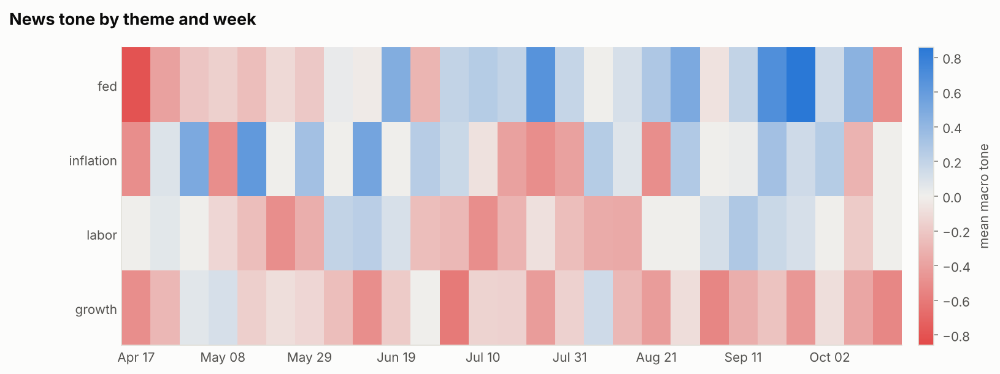
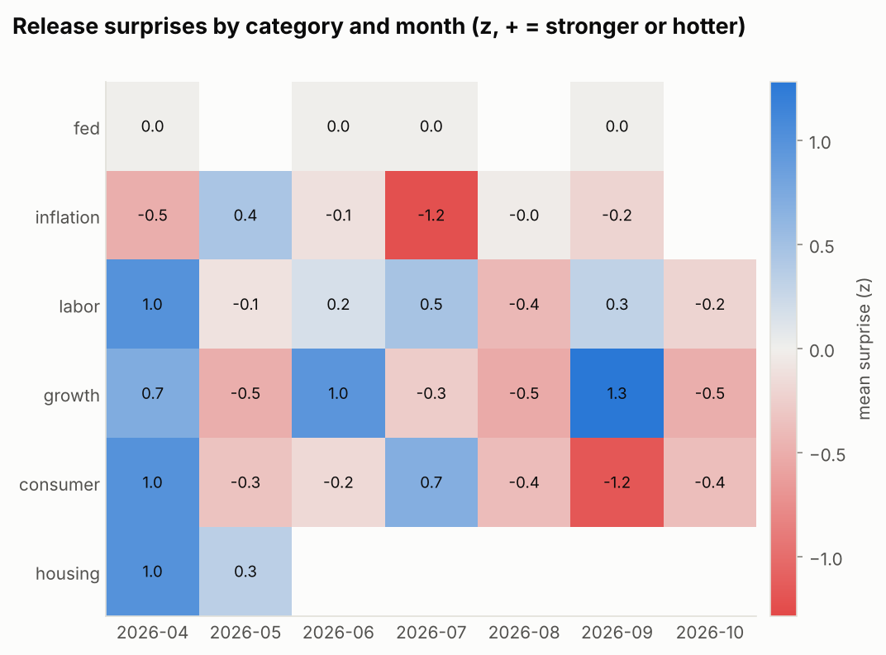
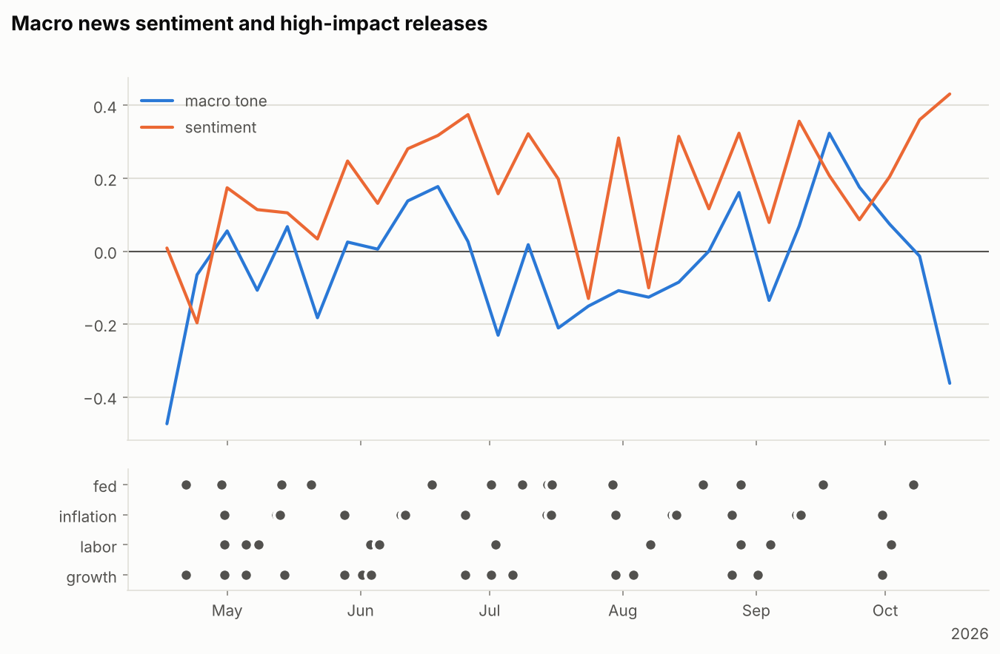
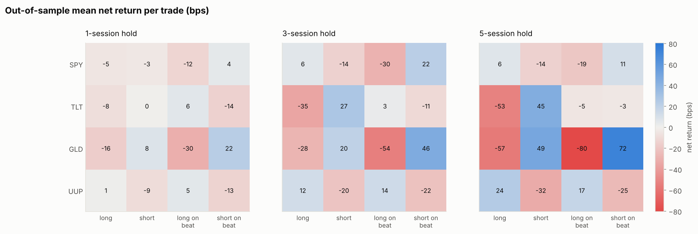
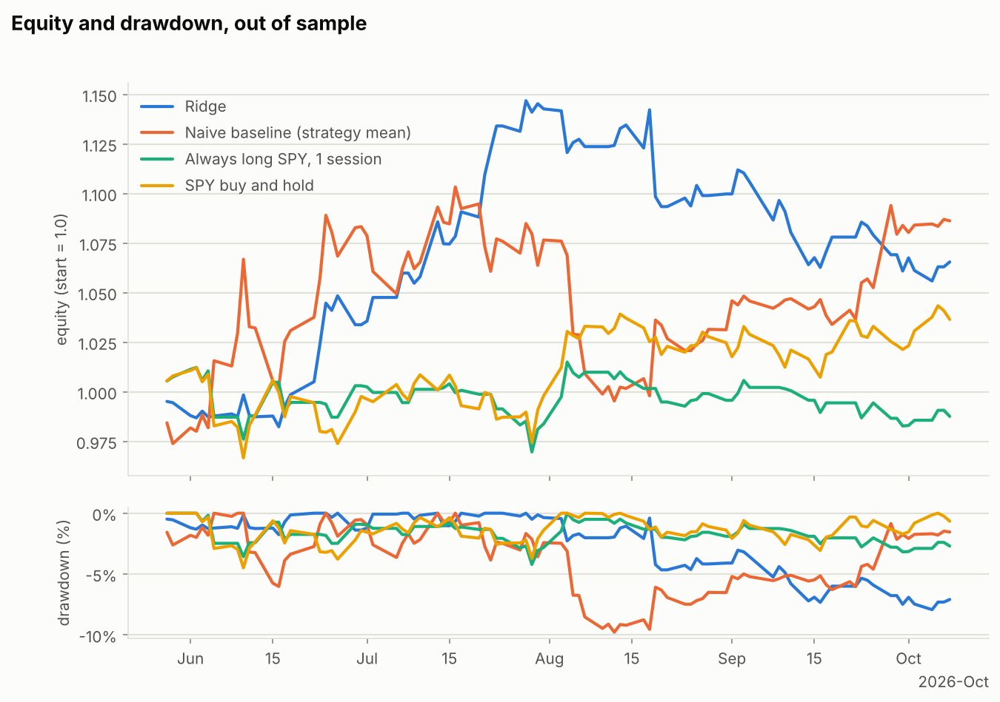

# Evaluation report

_Generated 2026-10-12 14:33 UTC. Out-of-sample results from purged walk-forward validation (docs/design.md section 7)._

## Key findings

- Out of sample: 86 release slots from 2026-05-28 to 2026-10-08, each traded at the first price after the release, with 2 bps of costs per side.
- Best Sharpe ratio: Ridge, 1.27 (90% interval -1.39 to 4.51), Sortino 1.87, max drawdown -7.9%, total return 6.6%.
- Other Sharpe ratios: Naive baseline (strategy mean) 1.16; Gradient boosting -1.14; Always long SPY, 1 session -0.30; SPY buy and hold 0.84.
- Strategy ranking, rank IC: baseline 0.124 (t = 3.38); ridge 0.021 (t = 0.40); hgb -0.028 (t = -0.56). Only |t| of 2 or more marks a reliable ranking.
- Win-rate forecasts: AUC 0.49 to 0.55 (0.50 is a coin flip).
- Every 90% Sharpe interval includes zero, so with this sample no strategy's edge is distinguishable from noise.

## Data coverage

### Events by category

| category | events | with_actual | first | last |
| --- | --- | --- | --- | --- |
| consumer | 21 | 18 | 2026-04-24 | 2026-11-06 |
| fed | 33 | 4 | 2026-04-17 | 2026-10-28 |
| growth | 51 | 43 | 2026-04-15 | 2026-11-04 |
| housing | 4 | 4 | 2026-04-21 | 2026-05-28 |
| inflation | 71 | 57 | 2026-04-30 | 2026-11-10 |
| labor | 69 | 59 | 2026-04-16 | 2026-11-06 |
| other | 34 | 0 | 2026-04-15 | 2026-10-07 |

### Release-time anchors

| event | releases | times_et |
| --- | --- | --- |
| ADP Non-Farm Employment Change | 7 | 08:15 |
| CPI m/m | 7 | 08:30 |
| CPI y/y | 7 | 08:30 |
| Core CPI m/m | 7 | 08:30 |
| Core CPI y/y | 7 | 08:30 |
| Federal Funds Rate | 5 | 14:00 |
| Non-Farm Employment Change | 7 | 08:30 |

### News by provider and theme

| provider | theme | articles | first | last |
| --- | --- | --- | --- | --- |
| exa | fed | 244 | 2026-04-15 | 2026-10-12 |
| exa | growth | 242 | 2026-04-15 | 2026-10-11 |
| exa | inflation | 249 | 2026-04-15 | 2026-10-12 |
| exa | labor | 256 | 2026-04-16 | 2026-10-10 |
| tavily | fed | 9 | 2026-10-06 | 2026-10-11 |
| tavily | growth | 3 | 2026-10-05 | 2026-10-11 |
| tavily | inflation | 6 | 2026-10-06 | 2026-10-10 |
| tavily | labor | 5 | 2026-10-08 | 2026-10-09 |

### Prices by symbol

| symbol | sessions | first | last |
| --- | --- | --- | --- |
| GLD | 164 | 2026-02-17 | 2026-10-09 |
| SPY | 164 | 2026-02-17 | 2026-10-09 |
| TLT | 164 | 2026-02-17 | 2026-10-09 |
| UUP | 164 | 2026-02-17 | 2026-10-09 |
| ^VIX | 164 | 2026-02-17 | 2026-10-09 |

### Slots and trades

| slots | slots_with_surprise | panel_rows | oos_slots |
| --- | --- | --- | --- |
| 117 | 85 | 4736 | 86 |

## Walk-forward set-up

- **As-of date:** 2026-10-12
- **Window:** 2026-04-15 to 2026-11-11
- **Sessions in the calendar:** 164
- **Minimum training slots:** 30
- **Walk-forward step:** 1
- **Out-of-sample period:** 2026-05-28 to 2026-10-08
- **Folds:** 86
- **Models:** regressors baseline, ridge, hgb; classifiers baseline_clf, logit, hgb_clf
- **Selection:** each slot trades the strategy with the highest predicted net return when it is above zero, otherwise stays flat
- **Costs:** 2.0 bps per side
- **Purging:** a fold trains only on trades that exited before the test slot's entry

## Predictive accuracy

| model | target | n_slots | n_preds | rank_ic | rank_ic_t | hit_rate | mae | auc | brier |
| --- | --- | --- | --- | --- | --- | --- | --- | --- | --- |
| baseline | net_ret | 86 | 3,536 | 0.124 | 3.38 | 55.5% | 1.01% | n/a | n/a |
| ridge | net_ret | 86 | 3,536 | 0.021 | 0.40 | 49.2% | 1.04% | n/a | n/a |
| hgb | net_ret | 86 | 3,536 | -0.028 | -0.56 | 48.9% | 1.07% | n/a | n/a |
| baseline_clf | win | 86 | 3,536 | 0.101 | 3.19 | 56.2% | n/a | 0.554 | 0.255 |
| logit | win | 86 | 3,536 | -0.036 | -0.92 | 50.1% | n/a | 0.490 | 0.257 |
| hgb_clf | win | 86 | 3,536 | -0.014 | -0.29 | 50.4% | n/a | 0.505 | 0.263 |

Rank IC: mean per-slot Spearman correlation between predicted and realised net return across strategies. Hit rate: share of predictions with the right sign (classifiers: probability above 0.5 matches the outcome). AUC and Brier score apply to the win classifiers.

## Strategy performance

| strategy | sharpe | sharpe_lo | sharpe_hi | sortino | max_drawdown | total_return | cagr | ann_vol | exposure | n_days | n_trades | win_rate | avg_return | profit_factor |
| --- | --- | --- | --- | --- | --- | --- | --- | --- | --- | --- | --- | --- | --- | --- |
| Naive baseline (strategy mean) | 1.16 | -1.13 | 3.87 | 1.91 | -9.8% | 8.6% | 25.1% | 21.3% | 100.0% | 93 | 86 | 55.8% | 0.38% | 1.33 |
| Ridge | 1.27 | -1.39 | 4.51 | 1.87 | -7.9% | 6.6% | 18.8% | 14.3% | 86.0% | 93 | 86 | 59.3% | 0.16% | 1.46 |
| Gradient boosting | -1.14 | -4.56 | 1.48 | -1.56 | -8.2% | -5.7% | -14.8% | 13.2% | 92.5% | 93 | 86 | 46.5% | -0.30% | 0.67 |
| Always long SPY, 1 session | -0.30 | -2.99 | 1.67 | -0.43 | -4.2% | -1.2% | -3.3% | 9.7% | 66.7% | 93 | 86 | 44.2% | -0.05% | 0.84 |
| SPY buy and hold | 0.84 | -1.76 | 3.07 | 1.25 | -4.5% | 3.6% | 10.2% | 12.5% | 100.0% | 93 | n/a | n/a | n/a | n/a |

Sharpe interval: 90% moving-block bootstrap (blocks of 5 sessions). Metrics use daily calendar-time returns, 252 sessions a year, risk-free rate 0.

## Best strategies out of sample

| strategy_id | mean_ret | win_rate | n |
| --- | --- | --- | --- |
| GLD\|short_on_beat\|5 | 0.72% | 64.5% | 62 |
| GLD\|short\|5 | 0.49% | 56.6% | 83 |
| GLD\|short_on_beat\|3 | 0.46% | 54.0% | 63 |
| TLT\|short\|5 | 0.45% | 66.3% | 83 |
| TLT\|short\|3 | 0.27% | 61.9% | 84 |
| UUP\|long\|5 | 0.24% | 68.7% | 83 |
| GLD\|short_on_beat\|1 | 0.22% | 50.0% | 64 |
| SPY\|short_on_beat\|3 | 0.22% | 57.1% | 63 |
| GLD\|short\|3 | 0.20% | 60.7% | 84 |
| UUP\|long_on_beat\|5 | 0.17% | 58.1% | 62 |

## Figures

## Notes

- Articles published after the as-of time: 3
- Events in the window without an actual value (upcoming or speeches): 98

## Limitations

- Small sample: about 180 days gives roughly 100 slots, so out-of-sample results carry wide confidence intervals.
- Daily bars: entry waits for the next open or close, so the immediate reaction to a release is only partly captured.
- Forecasts are the calendar site's consensus, not a survey of record.
- Sentiment from the macro tone lexicon and VADER is coarse.
- Costs are a flat 2 bps per side; slippage around releases can be larger.
- Early market closes are not modelled; a release after a 13:00 ET early close is treated as in-session.
